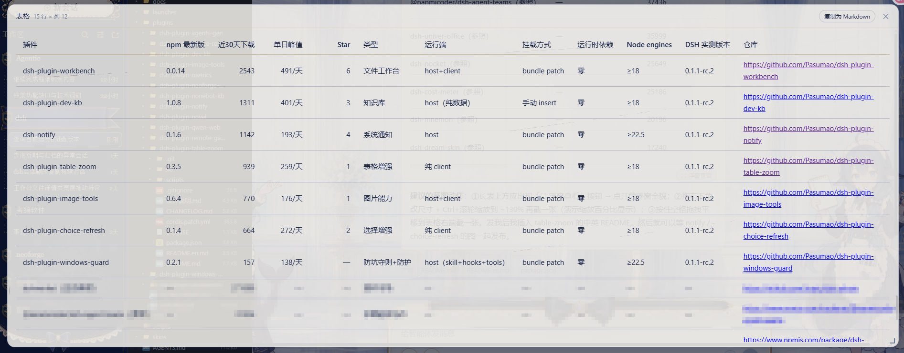

[中文](./README.md) | **English**

# dsh-plugin-table-zoom


A chat table float-window plugin for the DeepSeek Harness (dsh) Web GUI.

Markdown tables the model outputs in chat are often **very long (many rows) or very wide (horizontal overflow)**,
and can't be read in one pass within the conversation flow: you have to scroll the chat up and down and drag
left and right to see it all. This plugin automatically injects a small "⛶ Float view" (浮窗查看) button above
long tables; clicking it pops up a **standalone, scrollable float window** showing the full table, with
**one-click copy as Markdown**.

Pure front-end DOM enhancement: no core-package changes, no tool registration, no server-side logic, zero
runtime dependencies.

## Screenshot



> Real Web GUI screenshot (a large wide table → click "⛶ Float view" → browse the full table in the
> float window, with drag-to-resize / Ctrl+wheel zoom 60%–250% / Space-drag panning / one-click copy
> as Markdown).

## Features

- Long tables (≥ 9 rows including the header, or horizontal overflow beyond 2px) get a right-aligned
  "⛶ Float view" button below the table;
- Short tables are left alone;
- Clicking the button opens the float window: the title shows "Table · N rows × M columns", the body scrolls
  independently (both horizontally and vertically), it closes via the close button / Esc / clicking the
  overlay, and chat-page scrolling is locked while it is open;
- A "Copy as Markdown" button in the window header copies the whole table in one click (inline line breaks
  in cells are collapsed, pipe characters are escaped);
- The float window shows a **clone of the original table** — the table in chat stays untouched and is not
  enhanced twice;
- **Drag to resize**: the handle at the bottom-right corner freely adjusts the window size (minimum 320×200,
  maximum up to the viewport margins) and only affects the current open;
- **Re-fits every time it opens**: the window remembers no layout — width adapts to the table content
  (narrow tables don't fill the window; very large tables fill the available viewport width, floor of 320),
  position is centered, zoom is 100%; close and reopen and it returns to the adaptive state;
- **Drag to move**: hold the title bar to drag the window anywhere (kept within the page, it cannot be
  dragged off screen); the position only affects the current open;
- **Ctrl+wheel zoom**: hold Ctrl and scroll inside the window to zoom the table font from 60% to 250%
  (10% steps); the title bar shows the percentage live; **zoom is not remembered — every open resets to 100%**;
- **Text selection**: a normal left-click drag inside the table (including when zoomed) selects text,
  with no panning hijack;
- **Hold Space to pan**: when the table is wider/taller than the window, hold Space and drag the body to
  scroll left/right/up/down (the grab cursor appears only while Space is held; touch devices use native
  scrolling);
- **Clear scrollbars**: the body scrollbar is darkened and thickened so it stays visible in light themes;
- **Column width matching**: the column width cap matches in-chat tables (`min(30vw, 320px)`); overly wide
  columns wrap and shrink, so the table no longer breaks out of the window.

## Configuration

No configuration required — install and use:

- No environment variables are read, no API key / token is needed, no config files are written;
- The long-table thresholds (≥ 9 rows / 2px horizontal overflow) are built-in defaults, nothing to tune;
- Styling adapts to the DSH theme CSS variables; no separate theme configuration is introduced.

## Installation

```powershell
# npm (recommended)
dsh plugin --profile web add dsh-plugin-table-zoom
# or GitHub
dsh plugin --profile web add github:Pasumao/dsh-plugin-table-zoom
```

After installing, restart `dsh web` (the launcher brings it back up) and refresh the browser. The package
ships with its own `cordis.patch.yml` mount line, which `dsh plugin add` applies automatically — no manual
config edits needed.

Manual mounting (fallback, for when `dsh plugin add` is unavailable) — this is a pure client-side plugin
and must be mounted as a bundle into dsh's web profile (same mechanism as dsh-notify /
dsh-plugin-image-tools):

1. Install the dependency (in the profile directory, e.g. `~/.dsh/profiles/web`):

   ```bash
   npm install dsh-plugin-table-zoom
   # or install directly from GitHub
   npm install github:Pasumao/dsh-plugin-table-zoom
   ```

2. Add the plugin to `dsh.profile.bundles` in the profile's `package.json`:

   ```jsonc
   "dsh": {
     "profile": {
       "bundles": [
         /* ...existing bundles... */,
         "dsh-plugin-table-zoom"
       ]
     }
   }
   ```

3. Run `pnpm install` (or `npm install`) in the profile directory;
4. **Restart `dsh web`** (the launcher brings it back up) so the new plugin enters the browser bundle.

Install from source (local development / debugging):

```bash
git clone https://github.com/Pasumao/dsh-plugin-table-zoom.git
cd dsh-plugin-table-zoom
npm install
# mount into the profile as a link: dependency, see the note below
```

> For local development/debugging, a `link:` dependency can replace step 1:
> `"dsh-plugin-table-zoom": "link:D:/path/to/dsh-plugin-table-zoom"`.

## How it works

- Server side (`lib/index.js`): an empty implementation. The plugin is mounted into the profile as a
  "bundled patch"; the client side is declared via `dsh.client` and delivered to the browser through
  `/plugins/dsh-plugin-table-zoom/client.js` (same mechanism as dsh-notify / dsh-plugin-image-tools).
- Client side (`lib/client.js`): a MutationObserver watches `document.body`, and rAF-coalesced scans find
  markdown tables (the core renderer wraps tables in a container whose class contains `tableScroll`); a
  button row is injected after the container for long tables. Clicking the button imperatively creates the
  float window (reusing image-tools' lightbox pattern: a single pure-DOM node change, no insertion/removal
  of React-managed structures, safe across re-renders).

## Development

```sh
npm run selfcheck    # offline pure-function tests (detection / long-table check / Markdown serialization)
npm run smoke        # selfcheck + fake-DOM end-to-end smoke test (button injection / window open-close / copy)
npm run pack         # pack the plugin
```

## Compatibility

- Target: DeepSeek Harness Web GUI (dsh web); adapts to skins and theme CSS variables;
- Requires browser `MutationObserver` / `requestAnimationFrame`; auto-disables without a DOM environment;
- Does not affect other plugins: only tables inside `tableScroll` containers are matched, and tables inside
  float windows and the image-tools lightbox are skipped;
- Since dsh `0.1.1-rc.2`, the core renderer has an `md-table-wide` branch for wide tables with 4+ columns
  (width extends into the whitespace on both sides of the chat content column, `overflow-x:hidden` by
  default with the scrollbar appearing only on hover). The plugin injects an override rule that pulls wide
  tables back to the content column width with a persistent horizontal scrollbar, restoring the classic
  "scroll wide tables within the conversation column" experience; older dsh versions have no
  `md-table-wide` class, so the rule does not match and behavior is unchanged.

## Related plugins

This plugin is part of **Pasumao's dsh plugin ecosystem**; the published plugins in this family work well
together:

| Plugin (npm) | GitHub | Description |
|---|---|---|
| [dsh-notify](https://www.npmjs.com/package/dsh-notify) | [GitHub repo](https://github.com/Pasumao/dsh-plugin-notify) | Native Windows notifications + system tray |
| [dsh-plugin-choice-refresh](https://www.npmjs.com/package/dsh-plugin-choice-refresh) | [GitHub repo](https://github.com/Pasumao/dsh-plugin-choice-refresh) | Choice enhancements: regenerate options / more options |
| [dsh-plugin-dev-kb](https://www.npmjs.com/package/dsh-plugin-dev-kb) | [GitHub repo](https://github.com/Pasumao/dsh-plugin-dev-kb) | Plugin-development knowledge base (full official-docs mirror + skill) |
| [dsh-plugin-image-tools](https://www.npmjs.com/package/dsh-plugin-image-tools) | [GitHub repo](https://github.com/Pasumao/dsh-plugin-image-tools) | Image choice cards + inline images in replies + image intake for blind models |
| [dsh-plugin-workbench](https://www.npmjs.com/package/dsh-plugin-workbench) | [GitHub repo](https://github.com/Pasumao/dsh-plugin-workbench) | VS Code-style file explorer + editable preview |
| [dsh-plugin-windows-guard](https://www.npmjs.com/package/dsh-plugin-windows-guard) | [GitHub repo](https://github.com/Pasumao/dsh-plugin-windows-guard) | Windows pitfall protection: guideline skills + mojibake detection / dangerous-write blocking / encoding diagnosis & repair |

> The rest of the series: [Pasumao · dsh plugins](https://github.com/Pasumao); if you find these useful,
> a ⭐ on GitHub is appreciated.

## AI generation disclosure

Code and docs are AI-assisted (DeepSeek Harness), all human-reviewed and verified on a live install
(`npm run smoke`: selfcheck + fake-DOM end-to-end smoke test).

## License

MIT
